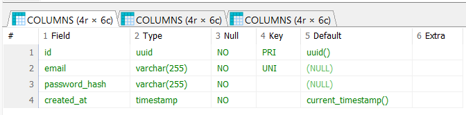
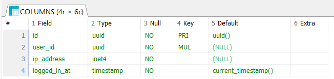
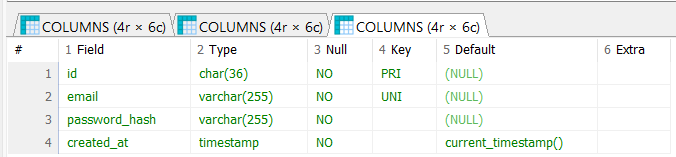
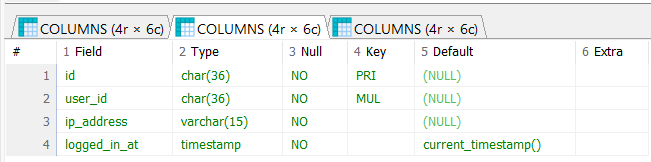
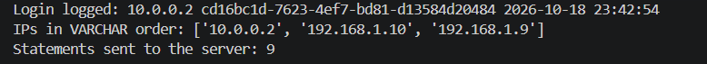
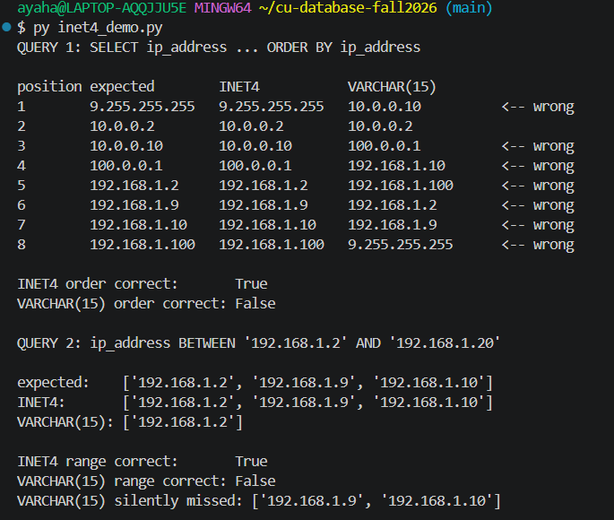
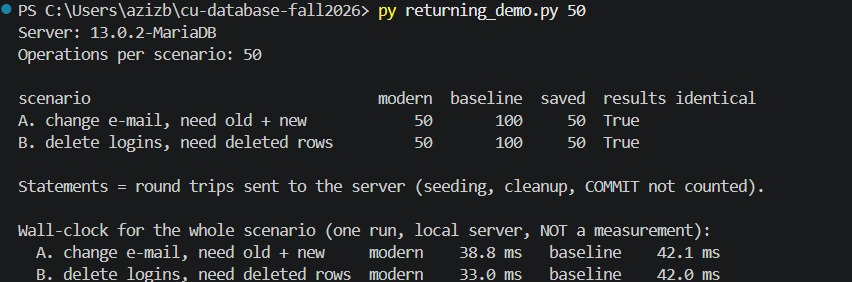
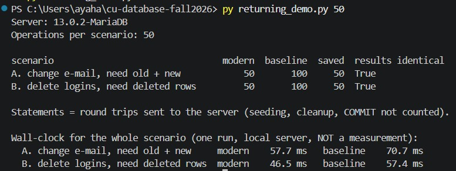
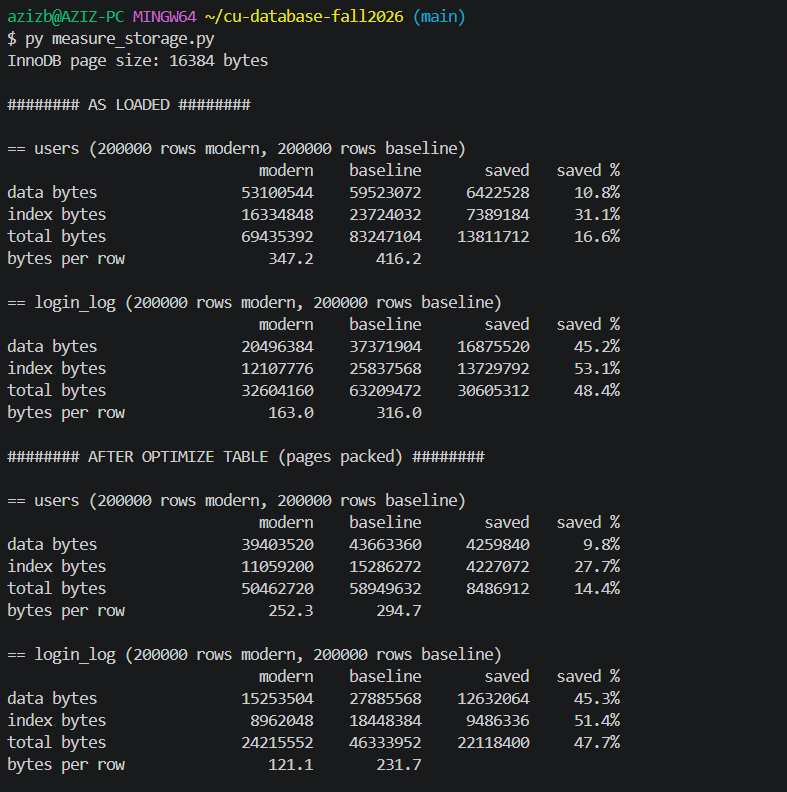
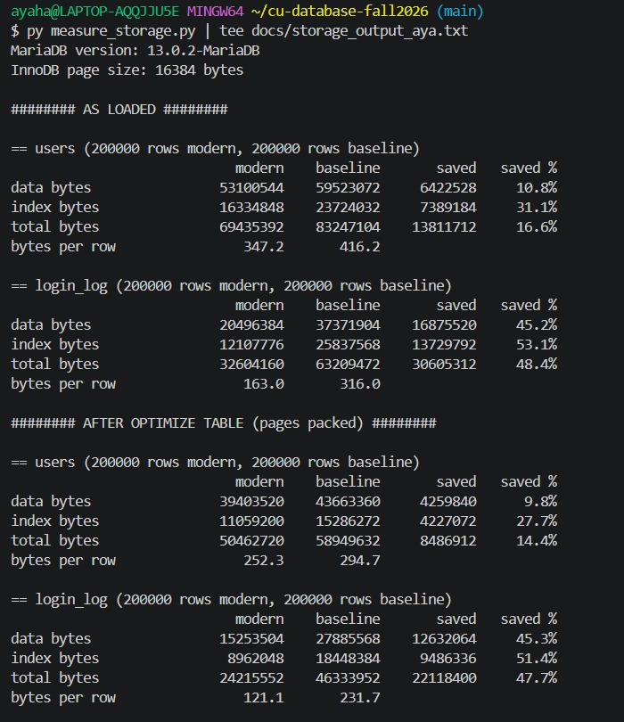

A project for area 1, "SQL that saves you work" for the [MariaDB student database projects, 2026-09](https://mariadb.org/bachelor_hackathon_2026-09/).

# SQL that saves you work: UUID, INET4 and RETURNING in MariaDB

**Team Data Titans:** Aya Hassen and Aziz Ben Othman, Constructor University (Databases, bachelor's).

**Status:** all planned measurements are done. Nothing in this README claims a result that has not been measured; what we did not measure is listed in section 9.

**Developed against:** MariaDB 13.0.2 (Windows, local install on both team machines). Tested with Python 3.13.4 and 3.14.3 and `mysql-connector-python` 26.7.0.

## 1. What this project is

MariaDB has a set of small SQL features that remove work you would otherwise do in application code. This repository takes three of them and builds one small application twice:

- a **modern** version that uses the features, and
- a **baseline** version that does the same job the way it is done without them.

The application is a signup service with a login log: users register, and every login records the user and the IP address it came from. The point is not the application. The point is the comparison, so a reader can see what each feature saves, with numbers, and also where it saves nothing.

| Feature | Modern version | Baseline version | What we compare |
|---|---|---|---|
| `UUID` type | `UUID` column, generated by the server with `DEFAULT UUID()` | `CHAR(36)`, generated in Python | Bytes per row, index size, correctness |
| `INET4` type | `INET4` column, 4 bytes | `VARCHAR(15)` string | Bytes per row, sort and range-query correctness |
| `RETURNING` | `INSERT ... RETURNING` | Write, then a separate `SELECT` where the server produced a value | Statements (round trips) per operation |

## 2. Progress

| Part | State |
|---|---|
| Schema, four tables | Done, loaded and verified on MariaDB 13.0.2 (section 3) |
| Modern app (`app_modern.py`) | Done, run on MariaDB 13.0.2: signup with `RETURNING`, login log with `INET4`, statement counter |
| Baseline app (`app_baseline.py`) | Done, run on MariaDB 13.0.2 (Python 3.13.4): 9 statements vs 5 for the modern app, IPs in text order (section 5) |
| `INET4` demo (`inet4_demo.py`) | Done, run on MariaDB 13.0.2 (section 5) |
| `RETURNING` comparison (`UPDATE`, `DELETE`) | Done (`returning_demo.py`), run on MariaDB 13.0.2 on both team members' machines: 1 statement vs 2 per operation, identical results (section 5) |
| Data generator (`generate_data.py`) | Done: 200,000 users and 200,000 logins, fixed seed, identical rows in both versions |
| Storage measurement (`measure_storage.py`) | Done on MariaDB 13.0.2 on both team members' machines, byte-identical output (section 5) |
| Timing measurements | Not done. We report sizes and statement counts only |

## 3. Data model

Four tables, two per version. They have the same structure and differ only in column types and in where the id comes from. The schema is in [`database/schema.sql`](database/schema.sql), and this section must always agree with that file.

```sql
-- Modern: native UUID and INET4, ids generated by the server
CREATE TABLE users_modern (
    id            UUID         NOT NULL DEFAULT UUID(),
    email         VARCHAR(255) NOT NULL,
    password_hash VARCHAR(255) NOT NULL,
    created_at    TIMESTAMP    NOT NULL DEFAULT CURRENT_TIMESTAMP,
    PRIMARY KEY (id),
    UNIQUE KEY uq_users_modern_email (email)
) ENGINE=InnoDB;

CREATE TABLE login_log_modern (
    id           UUID      NOT NULL DEFAULT UUID(),
    user_id      UUID      NOT NULL,
    ip_address   INET4     NOT NULL,
    logged_in_at TIMESTAMP NOT NULL DEFAULT CURRENT_TIMESTAMP,
    PRIMARY KEY (id),
    KEY idx_login_log_modern_user (user_id),
    CONSTRAINT fk_login_log_modern_user
        FOREIGN KEY (user_id) REFERENCES users_modern (id)
) ENGINE=InnoDB;

-- Baseline: CHAR(36) and VARCHAR(15), ids generated by the application
CREATE TABLE users_baseline (
    id            CHAR(36)     CHARACTER SET ascii COLLATE ascii_bin NOT NULL,
    email         VARCHAR(255) NOT NULL,
    password_hash VARCHAR(255) NOT NULL,
    created_at    TIMESTAMP    NOT NULL DEFAULT CURRENT_TIMESTAMP,
    PRIMARY KEY (id),
    UNIQUE KEY uq_users_baseline_email (email)
) ENGINE=InnoDB;

CREATE TABLE login_log_baseline (
    id           CHAR(36)    CHARACTER SET ascii COLLATE ascii_bin NOT NULL,
    user_id      CHAR(36)    CHARACTER SET ascii COLLATE ascii_bin NOT NULL,
    ip_address   VARCHAR(15) CHARACTER SET ascii NOT NULL,
    logged_in_at TIMESTAMP   NOT NULL DEFAULT CURRENT_TIMESTAMP,
    PRIMARY KEY (id),
    KEY idx_login_log_baseline_user (user_id),
    CONSTRAINT fk_login_log_baseline_user
        FOREIGN KEY (user_id) REFERENCES users_baseline (id)
) ENGINE=InnoDB;
```

**Why this design.**
- One user has many login events (one-to-many), so each log table carries a foreign key to its own users table. The modern and baseline pairs never reference each other.
- Both versions have identical constraints, keys and indexes, and the same storage engine (InnoDB). Any measured difference therefore comes from the column types and the statements used, not from the schema shape.
- The baseline columns use the `ascii` character set. Without it, MariaDB would store the text in the wider default character set and make the baseline look worse than it fairly is.
- The baseline ids have no `DEFAULT UUID()`. The application generates them, so it already knows the id and needs no read-back for it. This keeps the `RETURNING` comparison honest (section 6).
- Every login-log row holds two UUID-typed values (`id` and `user_id`), so the type's effect on storage shows up twice per row.

### Verification: the types as MariaDB reports them

`DESCRIBE` run in HeidiSQL against MariaDB 13.0.2. The modern tables show `uuid` and `inet4`, the baseline tables show `char(36)` and `varchar(15)`.









A diagram of the four tables is in [`docs/Data_Titans_Schemas.pdf`](docs/Data_Titans_Schemas.pdf).

## 4. The three features, in plain words

**`UUID`.** A UUID is a 128-bit identifier that can be generated without coordination between servers. Without the native type it is usually stored as its 36-character text form in `CHAR(36)`. MariaDB's `UUID` type stores it in 16 bytes and understands what it is.

**`INET4`.** An IPv4 address stored as text sorts alphabetically, so `192.168.1.10` sorts before `192.168.1.9`. `INET4` stores the real 4-byte value, so it sorts and compares numerically and range queries work as expected.

**`RETURNING`.** `INSERT`, `UPDATE` and `DELETE` can hand back the rows they touched in the same statement, so the follow-up `SELECT` is not needed.

```sql
INSERT INTO users_modern (email, password_hash)
VALUES ('aya@example.com', 'hash')
RETURNING id, created_at;
```

## 5. Findings

### Statements per signup flow (measured)

Both apps run the same flow: one signup, three logins, then one `SELECT` that lists the user's IP addresses in order. Every statement sent to the server is counted. Modern app run on MariaDB 13.0.2 (Aya); baseline app run on MariaDB 13.0.2 with Python 3.13.4 (Aziz).

| Step | Modern | Baseline |
|---|---|---|
| Signup | 1 (`INSERT ... RETURNING id, created_at`) | 2 (`INSERT`, then `SELECT created_at`) |
| 3 logins | 3 (`INSERT ... RETURNING id, logged_in_at`) | 6 (`INSERT`, then `SELECT logged_in_at`, each) |
| List the IPs in order | 1 | 1 |
| **Total** | **5** | **9** |



The 4 extra baseline statements are all read-backs of values the **server** produces (`created_at`, `logged_in_at`). The baseline needs no read-back for the id, because it generates the id itself. The last line of the screenshot is the baseline result; the IP order it prints (`10.0.0.2`, `192.168.1.10`, `192.168.1.9`) is the text order from the `INET4` finding below.

### `INET4` against `VARCHAR(15)` (measured)

`inet4_demo.py` puts the same 8 IPv4 addresses into both versions and runs two queries on each. The expected answer is computed in Python with the `ipaddress` module, so "correct" means numerically correct. Run on MariaDB 13.0.2.



| Query | `INET4` | `VARCHAR(15)` |
|---|---|---|
| `ORDER BY ip_address` (8 addresses) | Correct, 8 of 8 in place | Wrong, 7 of 8 in the wrong position (`9.255.255.255` sorted last) |
| `ip_address BETWEEN '192.168.1.2' AND '192.168.1.20'` (3 addresses should match) | Correct, 3 of 3 returned | Wrong, 1 of 3 returned |

`VARCHAR(15)` compares addresses as text, so `192.168.1.10` sorts before `192.168.1.9`. The range query returned an incomplete result with no error: it silently missed `192.168.1.9` and `192.168.1.10`. A table that is queried by range can therefore return wrong data without any warning. `INET4` gave the correct result on both queries.

### `RETURNING` against a separate `SELECT` (measured)

`returning_demo.py` runs two scenarios where the application needs data that only the server holds. Each scenario runs N times, once with `RETURNING` and once the classic way. The baseline uses `SELECT ... FOR UPDATE` first, so no row can slip in between the read and the write. That makes the baseline safe, so the statement count is an honest comparison. Every row returned by `RETURNING` is compared with what the baseline read back. Run on MariaDB 13.0.2 on both team members' machines, with the same statement counts and identical results.

| Scenario | Modern | Baseline |
|---|---|---|
| A. Change an e-mail, need the old and the new value | 1 statement: `UPDATE ... RETURNING OLD_VALUE(email), email` | 2 statements: `SELECT ... FOR UPDATE`, then `UPDATE` |
| B. Delete a user's logins, need the deleted rows | 1 statement: `DELETE ... RETURNING` | 2 statements: `SELECT ... FOR UPDATE`, then `DELETE` |

| Operations | Scenario | Modern | Baseline | Saved | Results identical |
|---|---|---|---|---|---|
| 20 | A | 20 | 40 | 20 | True |
| 20 | B | 20 | 40 | 20 | True |
| 50 | A | 50 | 100 | 50 | True |
| 50 | B | 50 | 100 | 50 | True |





`RETURNING` removed exactly one round trip per operation, and the saving grows linearly with the number of operations. The returned data was identical to the baseline in every run. Statements are counted as round trips sent to the server; seeding, cleanup and `COMMIT` are not counted. We did not measure time: a single run on a local server is noise, so any timing difference here would be meaningless. In the two screenshots the modern version happened to be faster in all four wall-clock lines (for example 57.7 ms against 70.7 ms on one machine), but each is a single run on a local server with no repetition, so we do not draw a conclusion from them. On a network with real latency each saved round trip would cost more, but we have not tested that.

`OLD_VALUE()` inside `RETURNING` for `UPDATE` requires MariaDB 13.0 or newer, so scenario A is skipped on older servers.

### Storage: `UUID` and `INET4` against `CHAR(36)` and `VARCHAR(15)` (measured)

`generate_data.py` loads 200,000 users and 200,000 logins into both versions. The rows are identical, including the ids: random version-4 UUIDs drawn from a fixed seed, inserted in the same order. `measure_storage.py` runs `ANALYZE TABLE` and reads `DATA_LENGTH` and `INDEX_LENGTH` from `information_schema.TABLES`. `DATA_LENGTH` includes the primary key, because InnoDB stores the table inside it; `INDEX_LENGTH` is all secondary indexes. Each table is measured twice: **as loaded**, and after `OPTIMIZE TABLE` rebuilt it with packed pages. Run on MariaDB 13.0.2 on both team members' machines. The output was identical on both, byte for byte.





**`login_log`** (200,000 rows, bytes). Each row holds two ids and one IP address, and the index on `user_id` repeats the user id next to the primary key.

| | Modern | Baseline | Saved | Saved % |
|---|---|---|---|---|
| Data, as loaded | 20,496,384 | 37,371,904 | 16,875,520 | 45.2% |
| Index, as loaded | 12,107,776 | 25,837,568 | 13,729,792 | 53.1% |
| **Total, as loaded** | **32,604,160** | **63,209,472** | **30,605,312** | **48.4%** |
| Per row, as loaded | 163.0 | 316.0 | 153.0 | |
| Data, after `OPTIMIZE` | 15,253,504 | 27,885,568 | 12,632,064 | 45.3% |
| Index, after `OPTIMIZE` | 8,962,048 | 18,448,384 | 9,486,336 | 51.4% |
| **Total, after `OPTIMIZE`** | **24,215,552** | **46,333,952** | **22,118,400** | **47.7%** |
| Per row, after `OPTIMIZE` | 121.1 | 231.7 | 110.6 | |

**`users`** (200,000 rows, bytes). Each row holds one id, an e-mail and a 97-character password hash.

| | Modern | Baseline | Saved | Saved % |
|---|---|---|---|---|
| Data, as loaded | 53,100,544 | 59,523,072 | 6,422,528 | 10.8% |
| Index, as loaded | 16,334,848 | 23,724,032 | 7,389,184 | 31.1% |
| **Total, as loaded** | **69,435,392** | **83,247,104** | **13,811,712** | **16.6%** |
| Per row, as loaded | 347.2 | 416.2 | 69.0 | |
| Data, after `OPTIMIZE` | 39,403,520 | 43,663,360 | 4,259,840 | 9.8% |
| Index, after `OPTIMIZE` | 11,059,200 | 15,286,272 | 4,227,072 | 27.7% |
| **Total, after `OPTIMIZE`** | **50,462,720** | **58,949,632** | **8,486,912** | **14.4%** |
| Per row, after `OPTIMIZE` | 252.3 | 294.7 | 42.4 | |

What the numbers show:

- **The saving depends on what else is in the row.** `login_log` rows are almost all ids and an address, so the types remove about 48% of the table and its index. `users` rows are mostly e-mail and password hash, which do not change, so the saving is 14 to 17%. The index on `users` shrinks more (28 to 31%) than its data (10 to 11%), because its entries are short: an e-mail plus the primary key.
- **The size of the types explains the direction.** `UUID` is 16 bytes, `CHAR(36)` in `ascii` is 36. `INET4` is 4 bytes; `VARCHAR(15)` stores 7 to 15 characters plus a length byte. Every secondary index copies the primary key, so a smaller id shrinks every index too.
- **Page fill is not the main cause.** Rebuilding with packed pages moves the total saving by about 1 point for `login_log` (48.4% to 47.7%) and about 2 for `users` (16.6% to 14.4%). Almost all of the saving comes from the column types.
- **The `login_log` figure combines two features.** It is `UUID` plus `INET4` together. We did not measure them separately, so we do not say how much each contributes.

How far to trust the sizes: they are allocated space, and InnoDB allocates in 1 MB steps once a table is past a few dozen pages. At 200,000 rows that rounding is a few percent of the table. Our first run, with 10,000 logins, reported a saving of exactly 1,048,576 bytes (one 1 MB step) for both the data and the index of `login_log`, which is a sign of that rounding. That is why the generator defaults to 200,000 rows.

### Summary of measurements

*Every row comes from a real run on MariaDB 13.0.2.*

| Measurement | Modern | Baseline | Difference |
|---|---|---|---|
| Statements: one signup, 3 logins, 1 final `SELECT` | 5 | 9 | 4 fewer (server-made values no longer need a read-back) |
| Statements per `UPDATE` or `DELETE` that needs the affected data | 1 | 2 | 1 fewer per operation (50 operations: 50 vs 100) |
| `INET4` sorting and range queries (8 addresses) | Correct | 7 of 8 positions wrong, range query missed 2 of 3 rows | Correctness, not size |
| `login_log` bytes per row, as loaded / after `OPTIMIZE` | 163.0 / 121.1 | 316.0 / 231.7 | 48.4% / 47.7% smaller |
| `users` bytes per row, as loaded / after `OPTIMIZE` | 347.2 / 252.3 | 416.2 / 294.7 | 16.6% / 14.4% smaller |

## 6. When each feature is worth it, and when it is not

*What our measurements confirmed or corrected (section 5):*

- **`RETURNING` is not about the id in our baseline.** The baseline generates its UUID in Python, so it already knows the id and does not need a read-back for it. `RETURNING` saves a round trip for values the **server** produces (such as `created_at`) and for `UPDATE` and `DELETE`, where the application otherwise has to `SELECT` first to know which rows changed. The comparison is built around those cases. Confirmed for `UPDATE` and `DELETE`: one statement instead of two (section 5). Where the application already knows the value, as with the Python-generated baseline id, `RETURNING` saves nothing.
- **`UUID` saves space, and how much depends on the table.** Ids of 16 bytes instead of 36 shrank `login_log`, with `INET4`, by about 48%, and `users` by 14 to 17%. Where the rows are mostly long text, as in `users`, the saving is small. We did not measure insert speed. A random UUID primary key scatters inserts across the index whichever type stores it, and the native type makes the key smaller, not sequential. We make no claim about speed.
- **`INET4` matters if you sort or filter by range, and it saves space.** With `VARCHAR(15)` our sort was wrong in 7 of 8 positions and the range query silently missed 2 of 3 rows (section 5). For a table that is only ever read by exact match, the gain is storage alone.

## 7. How to run it

Requirements: MariaDB 13.0 or newer (we used 13.0.2) and Python 3.13 or newer (tested with 3.13.4 and 3.14.3). `UUID` needs MariaDB 10.7+, `INET4` 10.10+, `INSERT ... RETURNING` 10.5+ and `UPDATE ... RETURNING` 13.0+, so everything except scenario A of `returning_demo.py` also runs on older servers.

The commands below use `py`, the Windows Python launcher. On Linux or macOS use `python3` instead. In Git Bash plain `python` can resolve to a different Python without pip, which is why we use `py`.

1. Install the connector:
   ```
   py -m pip install mysql-connector-python
   ```
2. Load the schema (HeidiSQL: open `database/schema.sql` in a query tab and press F9; or with the command-line client):
   ```
   mariadb -u root -p < database/schema.sql
   ```
   Running it a second time fails with "table already exists". To start clean, run `DROP DATABASE sql_features_project;` first.
3. Set the connection in environment variables. Nothing is hardcoded.
   ```
   set DB_PASSWORD=your_password           (cmd)
   $env:DB_PASSWORD="your_password"        (PowerShell)
   export DB_PASSWORD='your_password'      (Git Bash, Linux, macOS)
   ```
   Optional: `DB_HOST` (default `127.0.0.1`), `DB_USER` (default `root`), `DB_NAME` (default `sql_features_project`).
4. Run the modern app:
   ```
   py app_modern.py
   ```
   It signs up a user, logs three logins from different IP addresses, prints the addresses in `INET4` order and prints how many statements it sent to the server.

5. Run the baseline app, the `INET4` demo and the `RETURNING` demo:
   ```
   py app_baseline.py
   py inet4_demo.py
   py returning_demo.py        # 20 operations per scenario
   py returning_demo.py 50     # 50 operations per scenario
   ```
   `inet4_demo.py` and `returning_demo.py` import from `app_modern.py`, so run them from the repository root. Scenario A of `returning_demo.py` needs MariaDB 13.0 or newer and is skipped with a message on older servers. The script removes its own rows at the end.

6. Generate the data and measure storage:
   ```
   py generate_data.py        # 200,000 users and 200,000 logins into both versions
   py measure_storage.py      # sizes as loaded, then after OPTIMIZE TABLE
   ```
   `generate_data.py` first **empties all four tables** (`TRUNCATE`), so run it on a database you can reset. It accepts optional sizes (`py generate_data.py 1000 10000`), but small sizes make the 1 MB allocation steps visible and the saving unreliable. Run both scripts from the repository root.

**Data.** Generated by our own script with a fixed random seed (42), so every run produces the same ids, e-mails and IP addresses. The IP addresses mix one-, two- and three-digit parts, so text sorting goes wrong on them. All users share one password hash, because hashing 200,000 passwords would take far longer and says nothing about the features we compare.

## 8. How it was made

**Method.**
- **Statements.** Every statement sent to the server counts as one round trip. Seeding, cleanup and `COMMIT` are not counted. The baseline uses `SELECT ... FOR UPDATE` before `UPDATE` and `DELETE`, so it is safe against concurrent changes and the count is not inflated.
- **Correctness.** The expected sort order and range for `INET4` are computed in Python with the `ipaddress` module, not taken from the database. Every row returned by `RETURNING` is compared with what the baseline read back.
- **Storage.** `ANALYZE TABLE`, then `DATA_LENGTH` and `INDEX_LENGTH` from `information_schema.TABLES`, for all four tables, as loaded and after `OPTIMIZE TABLE`. Rows are counted with `COUNT(*)`.
- **Machines and repeats.** Windows, MariaDB 13.0.2, InnoDB page size 16,384 bytes, on both team members' machines. Each storage run was done once per machine. The data is generated from a fixed seed, and the two machines produced identical bytes. We did not measure timings.

Both applications use parameterized queries (`%s` placeholders, never string pasting), keep credentials out of the code, and count every statement sent to the server so round trips can be compared exactly.

```
database/           schema.sql
docs/               screenshots and the schema diagram
app_modern.py       application using UUID, INET4, RETURNING
app_baseline.py     same application without them
inet4_demo.py       INET4 against VARCHAR(15): sorting and range query
returning_demo.py   RETURNING against SELECT + UPDATE/DELETE: statement counts
generate_data.py    identical synthetic data in both versions (fixed seed)
measure_storage.py  storage sizes, modern against baseline
```

## 9. Limitations

- Two local servers (one per team member's machine), same version and settings. Statement counts do not depend on hardware. We did not measure timings, so we claim nothing about speed.
- Synthetic data, not production traffic. The data has about one login per user, which is unrealistic.
- Storage sizes are allocated space, which InnoDB rounds in 1 MB steps. At 200,000 rows that is a few percent. Smaller runs are less reliable.
- The ids are random version-4 UUIDs inserted in random order, the same on both sides. We did not test ids generated by the server (`DEFAULT UUID()`) or time-ordered ids, so we make no claim about them.
- The `login_log` saving combines `UUID` and `INET4`. We did not separate them.
- Three features only. We chose depth over a long list.

## 10. Team

| Name | Main responsibility |
|---|---|
| Aya Hassen | Modern version, `INET4` and `UUID` comparison |
| Aziz Ben Othman | Baseline version, `RETURNING` comparison |
| Both | Schema, data generation, measurements, this README |

## 11. References

- [MariaDB student database projects, 2026-09](https://mariadb.org/bachelor_hackathon_2026-09/), area 1
- MariaDB reference: [mariadb.com/docs](https://mariadb.com/docs) (UUID, INET4, RETURNING)